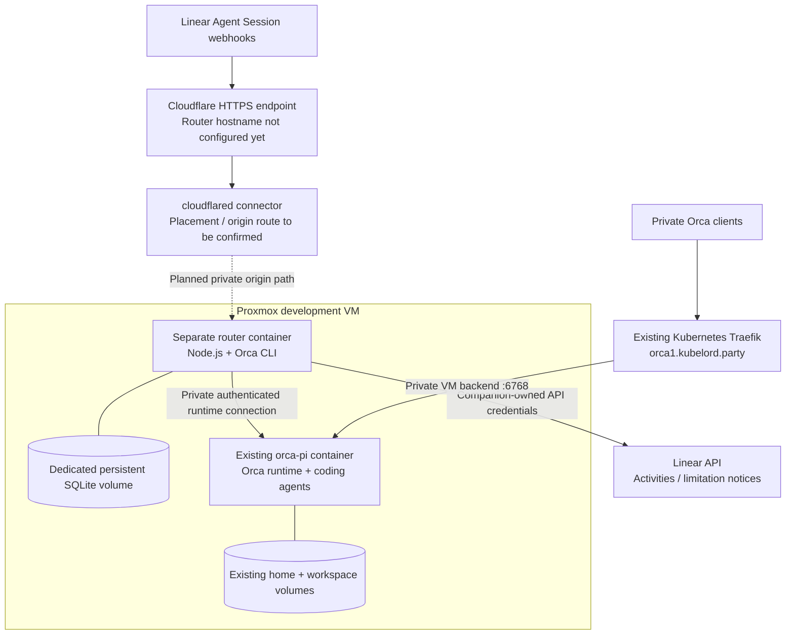

# Homelab deployment environment

## Purpose and evidence boundary

Describe the environment surrounding the initial Orca router, not a deployment runbook or authorization to change infrastructure. The behavioral plan remains in [the OpenSpec change](../openspec/changes/add-linear-session-created-mvp/proposal.md) and its [design](../openspec/changes/add-linear-session-created-mvp/design.md).

Sources were inspected read-only in `/workspace/homelab`, repository `https://github.com/ktersius/homelab`, at commit **`a765eb84921e5662fd9bbe505907a7da3ed7c87b`**. The nested `/workspace/homelab/homelab` directory was not used as the source. Paths in the source inventory below are relative to the homelab repository.

Evidence has three distinct levels:

- **Repository configuration:** describes intended configuration and documented prior checks, not current live health.
- **Operator-confirmed context:** the Orca image runs on a Proxmox VM; the router will have its own container; public ingress is intended to use a Cloudflare Tunnel, whose router route is not set up yet.
- **Proposed integration:** router placement, network attachment, public hostname, and origin port still require concrete deployment configuration.

No SSH, Docker runtime inspection, Kubernetes queries, Cloudflare account inspection, secret decryption, or live connectivity tests were performed for this document. No infrastructure was changed.

## Environment at a glance

| Area | Context |
| --- | --- |
| Compute | Docker on a Proxmox-hosted development VM; the exact VM ID, resources, OS, and provisioning owner were not established by this scan |
| Existing execution stack | `docker/orca-pi`, Compose project `orca-pi`, service `orca` |
| Router delivery | Separate Node.js + Orca CLI container; one replica and persistent SQLite volume, as agreed in OpenSpec |
| Runtime ownership | Existing Orca container owns agents, repositories, worktrees, credentials, and conversations |
| Existing private ingress | Kubernetes Traefik Gateway routes `orca1.kubelord.party` to the VM's Orca port |
| Intended public ingress | Cloudflare Tunnel to the router's webhook endpoint; hostname/origin mapping not configured yet |
| Infrastructure management | Homelab uses Ansible/Proxmox, Talos Kubernetes, Argo CD, Helm/Kustomize; this does not make the VM's Docker workloads Kubernetes-managed |

## Intended topology

The public tunnel is for **the router webhook**, not permission to publish the Orca runtime. The connector could reuse the existing Kubernetes tunnel if suitable or be placed elsewhere; the exact route is not selected here. Co-locating the router on the development VM is a reasonable candidate, not verified deployment configuration.

## Existing Orca runtime container

### Image and execution

The checked-in Compose file selects `homelab/orca-pi:1.4.224-1.1.0` and `linux/amd64`. The image is built from the adjacent Dockerfile; a registry publication or availability of that tag elsewhere is not established.

The Dockerfile currently pins:

- Node.js `24.21.0` on Debian bookworm-slim, with a base-image digest.
- Orca `1.4.224`, downloaded as an AppImage and checksum-verified/extracted at build time.
- Pi `1.1.0` and Codex CLI `0.162.1`, installed from the committed npm lock.

`orca-ide` is provided by the extracted Orca package. The runtime starts through `tini`, an initialization entrypoint, D-Bus, and Xvfb, running the packaged headless `serve` command on port `6768`. It includes Electron libraries despite being headless. Compose applies `no-new-privileges`; the launch script uses Chromium's `--no-sandbox`, so this is not proof of a strong sandbox for arbitrary agent commands.

Startup initializes volume ownership as root, then drops to **UID/GID 1000:1000**. Working directory is `/workspace`; the image includes Git, GitHub CLI, SSH client, Python, and common development tools. Availability of a binary does not prove authentication or agent integration.

### Persistent state and credentials

| Location | Ownership / role |
| --- | --- |
| Named `home` volume at `/home/orca` | Orca state/worktrees, Pi sessions/configuration/authentication, Codex state |
| Named `workspace` volume at `/workspace` | Repositories and development files |
| Read-only GitHub SSH-key bind mount | Copied into protected ephemeral runtime storage at startup |
| Read-only Git identity bind mount | Supplies commit name/email; not authentication or signing |
| Local ignored GitHub environment file | Optional GitHub token configuration |

Pi uses `/home/orca/.pi/agent`; Codex uses `/home/orca/.codex`. Their authentication is separate. Pi login, Codex device authorization, Git transport credentials, and GitHub API permissions must not be conflated. The runtime README distinguishes prior disposable smoke checks from authenticated provider requests and persistence tests that were not yet verified when documented.

The router should connect using its own runtime grant and companion-owned Linear credentials. It should **not mount the runtime home/workspace volumes, extract model credentials, or require the host Docker socket** to drive Orca. Branch/PR permissions belong in the execution environment. Existing GitHub credentials do not by themselves establish the MVP's no-merge/no-deploy permission boundary.

## Private networking and existing Orca ingress

The current Compose binding is **`192.168.1.169:6768:6768`**, and the advertised pairing endpoint is **`wss://orca1.kubelord.party`**. These are source-snapshot values, not constants to copy into router code.

The homelab's `kubernetes/tools/orca` application creates:

- A selectorless Service named `orca1` in namespace `tools`.
- A static EndpointSlice targeting the VM at `192.168.1.169:6768`.
- HTTPRoutes through the shared Traefik Gateway, HTTP-to-HTTPS redirection, and the Gateway's wildcard certificate.

ExternalDNS watches HTTPRoutes/services and uses an AdGuard webhook provider for internal DNS. The private Orca hostname does **not** imply a public Cloudflare route. Kubernetes manages the ingress objects, not the Orca container or its data; a cluster outage can break that hostname even if the VM runtime remains healthy.

The Orca README records a temporary operator-approved LAN-access exception: direct backend HTTP plus Orca pairing is reachable on the private VM port, without cluster-only firewall restriction. This is explicitly **not approval for public exposure**. Docker-published traffic may bypass ordinary host INPUT/UFW rules; any restriction must account for Docker forwarding or upstream/Proxmox firewalling.

A router container in another Compose project will not automatically resolve the service name `orca`. Choose and verify an explicit connection path: for example, an intentionally shared private Docker network, the permitted VM backend path, or the existing private TLS hostname. Do not assume `localhost` refers to the other container or that a host-bound published port is available on every host interface. Keep pairing grants secret and verify CLI/runtime compatibility and WebSocket support on the chosen path.

## Cloudflare context and planned webhook ingress

The repository already contains `kubernetes/network/cloudflare-tunnel`:

- Community `cloudflared` Helm chart pinned to `2.2.4`.
- One configured replica in namespace `network`.
- Tunnel name `kubelord`, automatic update disabled, info-level logging.
- References to a SealedSecret named `cloudflared-sealed-secret` for JSON and PEM credential files.
- **Commented-out ingress rules**; active public hostname/origin mapping cannot be determined from those values.

The maintained tunnel document says to inspect the Cloudflare dashboard, public DNS, internal DNS, rendered Secret references, and connector health before changing routes. An example Vaultwarden hostname in comments does not prove any current route, and the router hostname is not yet configured according to the operator.

For this MVP, the eventual path is public HTTPS → Cloudflare Tunnel → a reachable private router HTTP origin. Details remain to be supplied: public hostname, router listening port, connector placement, any intermediate gateway, routing/DNS, and access rules. If reusing the Kubernetes connector, confirm its network can reach the VM-hosted router; Docker service DNS on the VM is not automatically usable from a Kubernetes Pod.

Linear must reach the webhook without an interactive browser login. Any Cloudflare Access/WAF policy must accommodate webhook delivery without weakening the router's raw-body HMAC/freshness/workspace checks. Do not log secret-bearing payloads or runtime pairing links. The Cloudflare route grants access to the router endpoint only, not arbitrary execution targets.

## Persistence and recovery implications

- Give the router a separate durable SQLite volume. Losing it can lose knowledge of still-running remote workers; do not silently restart with empty state and assume the execution slot is free.
- Preserve Orca's existing home/workspace volumes; container recreation is not permission to remove them or clean up worktrees.
- Stopping the router does not stop workers in the other container. Recovery must reconcile persisted execution identities before new work starts.
- The homelab has Orca state-backup tooling, but its README says the deployed selection policy remains unresolved and blocks capture; synthetic checks do not prove real application recovery. Do not count that tooling as verified backup coverage for either runtime continuation or the new router database.
- Source control protects definitions and docs, not SQLite contents, model credentials, runtime grants, or worktrees. Router database backup/restore procedures still need to be selected and verified.

## Concrete deployment details still to establish

1. Router host placement, Compose ownership/project, image location/tag, listening port, private network, and persistent-volume path/permissions.
2. Runtime endpoint and separately revocable router grant; compatible CLI/runtime versions. The documented homelab pin is not proof that the orchestration guide inspected in the current agent session applies to that runtime.
3. Selected registered repository/backend and working provider/GitHub authentication with the intended permissions.
4. Actual cross-container coordinator identity, question/outcome JSON, acknowledgment/replay, stop behavior, and restart reconciliation—the existing OpenSpec contract-verification gate still applies.
5. Cloudflare webhook hostname, connector/origin route, reachability, TLS/access policy, and a real signed Linear delivery test.
6. SQLite backup/recovery, operator inspection, and manual blocked-worker resolution.

These are bounded deployment inputs and verification work, not a decision to build another connector, manage Proxmox from this application, replace existing ingress, or repackage the full Orca environment in the router image.

## Source inventory

Use the homelab commit above for this snapshot; consult current configuration before operating.

| Homelab path | Evidence |
| --- | --- |
| `AGENTS.md`, `README.md` | Layer ownership, GitOps/secret safety, overall Proxmox/Talos environment |
| `docker/orca-pi/README.md` | Runtime deployment, private ingress, authentication, retention, verification and backup limitations |
| `docker/orca-pi/compose.yaml` | Service/image, architecture, VM binding, mounts, environment, named volumes |
| `docker/orca-pi/Dockerfile`, `package.json` | Build/runtime pins, packaged CLI, installed tools and agents |
| `docker/orca-pi/runtime-entrypoint.sh`, `orca-serve.sh` | UID transition, credential/identity initialization, headless serving |
| `kubernetes/tools/orca/README.md`, `base/backend.yaml`, `values.yaml`, `kustomization.yaml` | Private route to the external VM workload |
| `kubernetes/network/external-dns/values.yaml` | Internal AdGuard-backed DNS discovery |
| `docs/cloudflare-tunnel-setup.md` | Tunnel operations and the need to check dashboard routing |
| `kubernetes/network/cloudflare-tunnel/values.yaml`, `kustomization.yaml` | Connector deployment and Secret references; no active hostname ingress rules in values |
| `terraform-proxmox/README.md` | Terraform owns Talos VM hardware; does not establish provisioning details of this separate development VM |

[Browse the inspected homelab snapshot](https://github.com/ktersius/homelab/tree/a765eb84921e5662fd9bbe505907a7da3ed7c87b).
